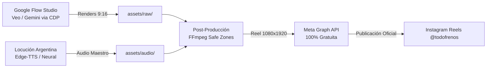

# 🚗 Todo Frenos — Pipeline Automatizado de Instagram con Google Flow

Pipeline de generación y publicación de contenido viral para la cuenta de Instagram de **Todo Frenos** (Taller especializado en frenos, torno propio y reparación de servofreno con +35 años de oficio en Gerli, Avellaneda).

Sitio web oficial: [todo-frenos.netlify.app](https://todo-frenos.netlify.app)

---

## ⚡ Arquitectura del Pipeline



---

## 📁 Estructura del Proyecto

```
gflow/
├── scripts/
│   ├── flow_generator.js       # Automatización de Google Flow (Chrome CDP port 9222)
│   ├── voice_generator.py      # Síntesis de voz argentina rioplatense (Edge-TTS)
│   └── instagram_publisher.py  # Publicador oficial via Meta Graph API
├── pipeline.py                 # Orquestador del flujo
├── package.json                # Configuración de Node.js
├── requirements.txt            # Dependencias de Python
└── README.md                   # Documentación técnica
```

---

## 🛠️ Requisitos & Configuración

1. **Google Chrome con Depuración Remota activa:**
   ```bash
   google-chrome --remote-debugging-port=9222 --user-data-dir=~/.config/google-chrome
   ```
   *(Tener iniciada la sesión en [flow.google.com](https://flow.google.com)).*

2. **Variables de entorno para publicación directa (Meta Graph API):**
   ```bash
   export INSTAGRAM_ACCOUNT_ID="tu_ig_user_id"
   export META_ACCESS_TOKEN="tu_page_access_token"
   ```

---

## 🚀 Uso Rápido

### Generar visuales en Google Flow:
```bash
node scripts/flow_generator.js "Vertical 9:16 cinematic shot of lathe rectifying brake disc"
```

### Generar locución de prueba:
```bash
python3 scripts/voice_generator.py "Si tu pedal de freno está duro como piedra, no sigas manejando..."
```

### Publicar Reel en Instagram:
```bash
python3 scripts/instagram_publisher.py --video-url "https://mi-servidor.com/reel1.mp4" --caption "Texto del post..."
```
